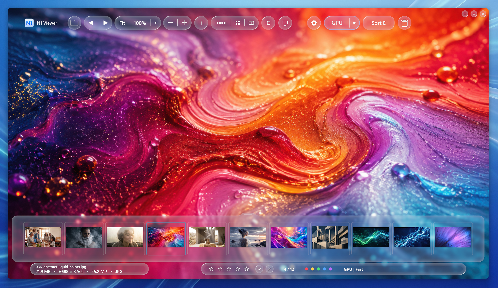
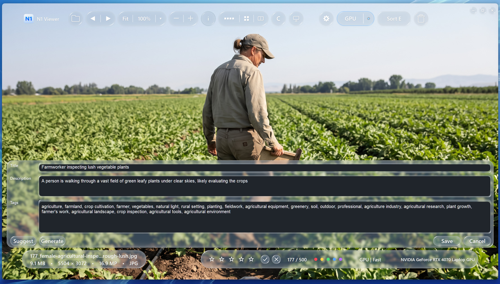
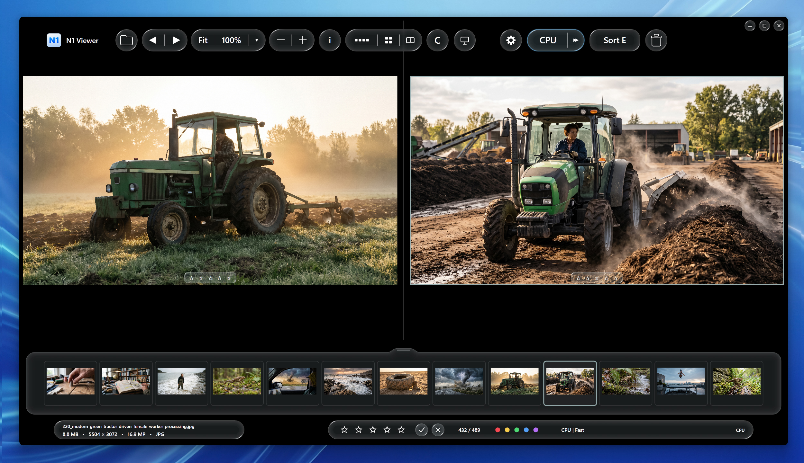

# N1 Viewer — Ultra-Fast Windows Photo Viewer with AI

**Fast JPEG Viewing • AI Auto Tags • AI Visual Search • RAW • HDR/WCG • Photo Culling • OCR**

N1 Viewer is a high-performance photo viewer for Windows 10/11, combining ultra-fast image browsing, GPU acceleration, advanced color management, local AI tools and photo management.

**[Official Website](https://n1viewer.com/) · [Microsoft Store](https://apps.microsoft.com/detail/9ntlxfcnw1cn) · [For Stock Photographers](https://n1viewer.com/stock-photographers/index.html)**

## ⚡ Ultra-Fast JPEG Viewing

Optimized decoding, intelligent caching, preloading and GPU acceleration deliver exceptionally fast navigation through large photo collections.

**Internal benchmarks — Intel Core i9-13900H, RTX 4070 Laptop GPU, ~20 MP JPEGs:**

- **12.59 ms** — best first-frame latency
- **18.35 ms** — median navigation latency
- **6.26 ms** — median thumbnail processing
- **10.33 ms** — thumbnail processing at p90

*Internal measurements; actual performance depends on hardware, images and cache conditions.*

**GPU selection:** Switch directly between discrete GPU and integrated GPU (iGPU) inside N1 Viewer.

## 🤖 AI Features

- **Advanced AI Auto Tags** — generates editable titles, descriptions and keywords, particularly useful for stock photographers.
- **AI Visual Search** — search photos by text descriptions or reference images.
- **Find Similar / Duplicate Search** — find related and duplicate images.
- **OCR** — recognize and extract text from images.
- **Local AI** — supported models run on your computer after downloading.

## 📷 Photo Management & Culling

Gallery, star ratings, color labels, pick/reject, filtering, sorting, metadata editing, duplicate search and side-by-side comparison.

**Auto Advance:** Automatically moves to the next image after a culling action.

**Two interfaces:** Customizable Modern UI (colors and transparency) and traditional Classic UI.

**Smooth fullscreen transitions and smooth zooming.**

## 📁 Image & RAW Formats

**Supported image formats:** JPEG / JPG / JPE / JFIF, HEIC / HEIF / HIF, AVIF, JPEG XR / JXR / WDP, PNG, WebP, TIFF / TIF, BMP, GIF, PSD, OpenEXR, Radiance HDR, JPEG XL.

**RAW formats:** CR2, CR3, DNG, NEF, NEF HE / HE Star, NRW, ARW, RAF, ORF, RW2, PEF, 3FR.

**Intelligent RAW viewing:** Uses embedded JPEG previews for fast browsing and automatically switches to decoded full-resolution RAW when preview detail is insufficient or the image is zoomed in.

## 🎨 Advanced Color Management

**Advanced Color Mode:** Extended ICC / Wide Gamut / HDR processing — Adobe RGB, Display P3 / DCI-P3, ProPhoto RGB, Rec.2020, Rec.2100 PQ / HLG, HDR10 / PQ, linear scRGB and custom embedded ICC profiles.

**Precision:** 8 / 10 / 12 / 16-bit source handling (where supported), HALF / FLOAT HDR sources, FP16 / scRGB presentation and selective FP32 processing for precision-sensitive Advanced transforms.

## 📥 Download

**[Get N1 Viewer on Microsoft Store — 15-Day Trial](https://apps.microsoft.com/detail/9ntlxfcnw1cn)**

Windows 10 / 11. Distributed through Microsoft Store.

## 🐛 Bug Reports & Feature Requests

Use **[GitHub Issues](https://github.com/n1viewer/n1-viewer/issues)** to report bugs, compatibility problems, performance issues or suggest improvements. Include your N1 version, Windows version, hardware and reproduction steps.

Version announcements and fixes: **[GitHub Releases](https://github.com/n1viewern/n1-viewer/releases)**.

## 🎁 Become a Tester — Get a Full-Version License

We're looking for active testers to help improve N1 Viewer!

1. Install the **15-day trial** from Microsoft Store.
2. Test JPEG/RAW viewing, AI tools, HDR/WCG, culling and other features.
3. Find and report reproducible bugs through GitHub Issues.
4. Help verify fixes and provide feedback.

**Active testers who help identify and report bugs can receive a free full-version license key after testing.**

**[Start Free Trial](https://apps.microsoft.com/detail/9ntlxfcnw1cn) · [Report an Issue](https://github.com/n1viewer/n1-viewer/issues)**

---

**N1 Viewer — Fast Browsing. Accurate Color. Smarter AI Workflows.**

[Official Website](https://n1viewer.com/) · [Stock Photographers](https://n1viewer.com/stock-photographers/index.html) · [Microsoft Store](https://apps.microsoft.com/detail/9ntlxfcnw1cn)

*Proprietary software. This repository contains product information, screenshots, documentation, issues and releases. Source code is not published.*
